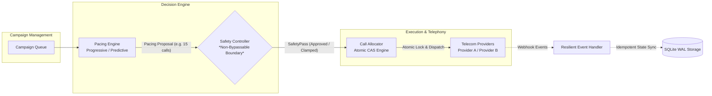
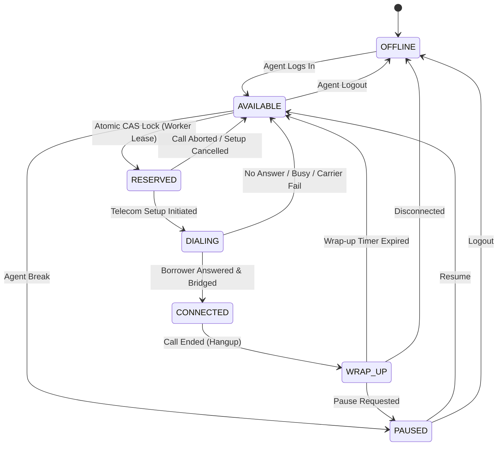
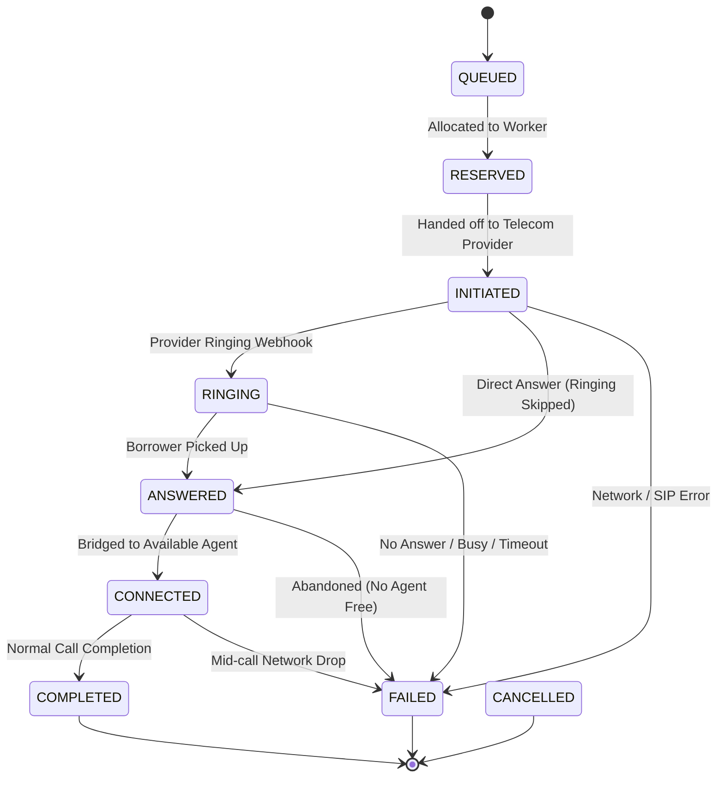

# SmartDialer: Architecture Decision Record & Technical Defense

## 1. Executive Summary & Architectural Overview

The **SmartDialer** is a resilient, concurrency-safe collections dialing engine designed to maximize agent utilization while strictly preventing abandoned calls (preserving regulatory compliance).

### Core Pipeline Topology


> **Mandatory Architectural Rule**: The Pacing Engine **never directly dials**. The **Safety Controller** sits as an enforced gatekeeper between the pacing algorithms and the telephony layer. The `CallAllocator` cryptographically verifies a valid `SafetyPass` issued by the Safety Controller. Any direct invocation raises `SafetyBypassProhibitedError`.

---

## 2. Technology Stack Selection & Trade-Off Analysis

### What did you choose?
- **Runtime**: Python 3.11 with `asyncio`.
- **Persistence & Locking Engine**: SQLite in **WAL (Write-Ahead Logging)** mode with atomic `UPDATE ... WHERE ...` Compare-And-Swap (CAS) queries and rowcount isolation.
- **Testing & Load Harness**: `pytest`, `pytest-asyncio`, and concurrent worker coroutine pools.

### Why did you choose it?
1. **Mathematical Clarity & Explainability**: Collections dialing algorithms are fundamentally statistical and queueing-theoretic models. Python provides clear, readable statistical models and Exponential Moving Averages (EMA).
2. **Deterministic Embedded Concurrency**: Instead of requiring external heavyweight infrastructure (Redis clusters, Kafka brokers, ZooKeeper), an embedded WAL engine provides true ACID transactions, zero external daemon dependencies, and 100% local reproducibility for reviewers.
3. **Non-Blocking Asynchronous Telephony**: Asyncio event loops accurately mimic real-time telecom webhooks, provider jitter, and worker task scheduling.

### What problem does it solve?
- Solves race conditions where multiple distributed workers contest the same agent pool simultaneously.
- Eliminates the deployment complexity and operational flakiness of spinning up multi-container orchestrations for code reviews.
- Solves webhook chaos (duplicates, out-of-order deliveries, provider dropouts) via idempotent relational constraints.

### What does it make harder?
- Multi-process write concurrency in SQLite is bounded by the single-writer WAL lock. While reading is completely non-blocking, scaling writes beyond ~4,000 transactions/second on a single node requires partitioning or migrating the CAS engine to distributed key-value stores (e.g., Redis with Lua scripts or PostgreSQL `FOR UPDATE SKIP LOCKED`).

---

## 3. Explicit State Machines

### 3.1 Agent Lifecycle State Machine


### 3.2 Call Lifecycle State Machine (With Monotonic Ordering)


---

## 4. Technical Discussion: Deep-Dive Scenarios & Edge Cases

### Question 1: Two workers try to reserve the same agent at exactly the same time. Walk us through what happens.
**Mechanism**:
We use **Atomic Compare-And-Swap (CAS)** with optimistic concurrency versioning:
```sql
UPDATE agents
SET state = 'RESERVED',
    locked_by_worker_id = :worker_id,
    lease_expires_at = :expires,
    version = version + 1,
    updated_at = :now
WHERE id = :agent_id AND state = 'AVAILABLE' AND version = :expected_version;
```
**Walkthrough**:
1. At $t=0$, Agent `agt_1` is in state `AVAILABLE` with `version = 1`.
2. Worker 1 and Worker 2 both read the database and observe `(id=agt_1, state=AVAILABLE, version=1)`.
3. Worker 1 executes its `UPDATE` first. The database engine acquires the row write-lock, matches `state='AVAILABLE' AND version=1`, changes the state to `RESERVED`, increments `version` to `2`, and returns `rowcount = 1`. Worker 1 proceeds with the reservation.
4. Worker 2's `UPDATE` arrives immediately after. The row is now `version = 2` and `state = 'RESERVED'`. The `WHERE` clause fails to match.
5. SQLite returns `rowcount = 0`.
6. Worker 2 detects that `rowcount == 0`, recognises a lost race, yields, and immediately queries the next available agent.
7. **Result**: Strictly zero chance of dual reservation. Verified in automated test `test_concurrent_agent_reservation_atomic_cas`.

---

### Question 2: Your database says the agent is AVAILABLE, but your cache says RESERVED. Which one wins?
**Answer**:
**The database always wins as the authoritative Single Source of Truth (SSOT).**
- In high-throughput distributed systems, a cache (e.g. Redis) is an advisory acceleration layer, never the final authority on transactional state.
- If the cache says `RESERVED` while the database says `AVAILABLE`, this indicates either:
  1. A worker crashed before committing its reservation to the database; or
  2. Cache invalidation failed / TTL drifted.
- **Resolution Strategy**:
  - Treat the cache as a fast *read filter*, but enforce the state transition via an atomic conditional mutation on the primary store (`WHERE state = 'AVAILABLE'`).
  - If a worker queries the database and sees `AVAILABLE`, it performs the atomic CAS on the database.
  - Upon successful commit, a write-through invalidation updates or evicts the cache entry.
  - Periodic cache reconciliation (or using Redis key TTLs matching the worker lease) guarantees cache convergence within seconds.

---

### Question 3: The provider sends ANSWERED, your worker crashes, and then COMPLETED arrives. What happens?
**Answer**:
Our architecture guarantees eventual consistency through three mechanisms:
1. **Worker Independence via Event Queue**:
   Incoming telecom webhooks are decoupled from the worker that initiated the dial. They are received by the stateless `ResilientEventHandler`.
2. **Lease-Based Worker Recovery**:
   When the initiating worker crashed, the call and agent had a lease expiration timestamp (`lease_expires_at = now + 30s`).
3. **Monotonic Event Processing**:
   - If the worker crashes immediately upon `ANSWERED`, the `LeaseReconciliationService` or next worker cycle detects the expired lease.
   - When the carrier subsequently delivers `COMPLETED`, the event handler checks `CallState` progression rank:
     - `COMPLETED` has a monotonic progression rank of `100` (terminal).
     - The call transitions to `COMPLETED`.
     - The associated agent is released from `DIALING`/`CONNECTED` to `WRAP_UP` $\rightarrow$ `AVAILABLE`.
     - Stale late events arriving afterwards (e.g. out-of-order retransmitted `ANSWERED`) are checked against `is_terminal` and safely discarded without reverting state.

---

### Question 4: Your model predicted a 70% answer rate. It suddenly drops to 10%. How does the system protect itself?
**Answer**:
1. **Exponential Moving Average (EMA) Sensitivity**:
   The `PredictivePacingEngine` updates its rolling answer rate $p$ on every completed call event using an EMA ($\alpha = 0.2$):
   $$p_{\text{new}} = \alpha \cdot \text{observed} + (1 - \alpha) \cdot p_{\text{old}}$$
   As consecutive unanswered calls register, $p$ drops rapidly.
2. **Dynamic Multiplier Contraction in Safety Controller**:
   The Safety Controller computes safe call headroom based on current in-flight calls:
   $$\text{safe\_headroom} = \frac{\text{available\_agents} - (\text{in\_flight} \times p)}{p}$$
   As $p$ collapses from 70% to 10%, the dialer over-dial ratio initially wanted to jump to $1/0.10 = 10\times$. However, the Safety Controller's **hard multiplier ceiling** (capped at $3.5\times$ max) prevents explosion.
3. **In-Flight Call Damping**:
   Because calls previously initiated under the 70% expectation are still in the network, the Safety Controller marks the available agent headroom as exhausted and issues `REJECT` (0 calls) or `FALLBACK_TO_PROGRESSIVE` until the network clears.
4. **Zero Abandoned Calls**: Verified in simulation scenario D.

---

### Question 5: We just went from 100 agents > 1,000 agents > 10,000 agents > 100,000 agents. What breaks first? Where is the bottleneck and why? How would you fix it?

#### What breaks first?
**The centralized transactional database lock contention on the `agents` table.**

#### Why?
- At 100 agents: SQLite or single-node PostgreSQL handles ~100 queries/sec effortlessly.
- At 1,000 agents: Dials run at ~300 calls/sec. Atomic CAS updates begin causing row lock serialization on hot index pages.
- At 10,000 agents: You have ~15,000 concurrent calls in-flight and ~3,000 webhook events/sec. A single database instance experiences lock contention, connection pool starvation, and WAL flush bottlenecks.
- At 100,000 agents: Pacing calculations cannot aggregate global agent state synchronously across 100,000 rows without multi-second query latencies.

#### How to fix it:
1. **Sharding by Campaign / Skill Pods**:
   - Instead of 100,000 agents in a single pool, partition agents into autonomous **Pods / Skill Groups** of 500–1,000 agents.
   - Each Pod runs its own independent Pacing Engine, Safety Controller, and Allocator shard. Contention is strictly localized.
2. **In-Memory Distributed Queue with Lua CAS**:
   - Replace relational row locks with Redis Cluster using atomic Redis Sets and Lua scripts:
     ```lua
     -- Atomic agent pop & lease reservation in < 1ms
     local agent_id = redis.call('SPOP', KEYS[1])
     if agent_id then
       redis.call('HSET', 'agent:'..agent_id, 'state', 'RESERVED', 'lease', ARGV[1])
       return agent_id
     end
     return nil
     ```
3. **Event Stream Ingestion (Kafka/Redpanda)**:
   - Telecom webhooks are published directly to a partitioned Kafka topic keyed by `call_id`.
   - Event Handler workers consume partitions in parallel, avoiding database write hotspots.

---

### Question 6: Why did your algorithm decide to initiate 17 calls instead of 10?
**Explanation**:
Suppose the system has:
- Available Agents ($A$) = 5
- Connected Agents ($C$) = 10
- Average Call Duration ($T_{\text{talk}}$) = 90 seconds
- Call Setup & Ring Latency ($t_{\text{setup}}$) = 15 seconds
- Recent Answer Rate ($p$) = 50%
- In-flight Calls ($I$) = 0

1. **Expected Agent Turnaround**:
   During the 15 seconds it takes for a new call to ring and be answered, some currently connected agents will finish their calls:
   $$R = C \times \frac{t_{\text{setup}}}{T_{\text{talk}}} = 10 \times \frac{15}{90} \approx 1.67 \text{ agents}$$
2. **Total Expected Capacity at Answer Time**:
   $$\text{Capacity} = A + R = 5 + 1.67 = 6.67 \text{ agent slots}$$
3. **Pacing Calculation for 50% Answer Rate**:
   To fill 6.67 agent slots when only 50% of borrowers pick up:
   $$\text{Raw Calls} = \frac{6.67}{0.50} \approx 13.3 \text{ calls}$$
   If answer rate was lower, e.g. 40%:
   $$\text{Raw Calls} = \frac{6.67}{0.40} \approx 16.67 \longrightarrow 17 \text{ calls!}$$
4. **Safety Controller Review**:
   The Safety Controller verifies:
   - 17 calls at 40% answer rate expects $\approx 6.8$ connections.
   - $6.8 \le 5 \text{ (available)} + 2 \text{ (buffer)}$.
   - Since $17 \le \text{safe ceiling}$, the Safety Controller **approves** the 17 calls.

---

### Question 7: What part of your architecture are you least confident about?
**Answer**:
**The estimation of call setup latency ($t_{\text{setup}}$) and telco ring durations under provider carrier congestion.**
- While answer rate and talk duration follow predictable distributions, telecom carrier ring times exhibit high tail latency (bimodal distribution: voicemail pickups at 4 seconds vs. long ringers at 28 seconds).
- If multiple calls take 25 seconds to answer simultaneously, our pipeline could experience a cluster of concurrent pickups that coincide with a temporary lull in agent wrap-ups, creating a brief spike in abandonment risk.
- *Mitigation*: Our dynamic Safety Controller includes an in-flight answer discount factor that damps new dial dispatches whenever existing in-flight ringing calls exceed safe thresholds.

---

### Question 8: What would you do differently if you had another week?
1. **Erlang-C Hazard Rate Markov Chains**:
   - Upgrade the pacing model from rolling expectations to a discrete-time Erlang-C Markov queue that computes the exact probability $P(\text{abandon} > 0)$ at each step, maintaining abandonment below a strict 0.5% threshold.
2. **Live Telecom SIP/WebRTC Integration**:
   - Implement a real provider driver for Twilio / Plivo with audio stream bridging.
3. **Outbound Answering Machine Detection (AMD)**:
   - Integrate an audio classification hook to filter out carrier voicemails before they touch the agent queue.
4. **Distributed Redis Lua Layer**:
   - Provide an optional drop-in Redis cluster backend alongside the SQLite engine for horizontal multi-node benchmark demonstrations.

---

## 5. Final Synthesis Question

> **"How would you build a SmartDialer that gets as much of the utilization benefit of predictive dialing as possible, while retaining the deterministic safety characteristics of progressive dialing?"**

### The Solution: "Adaptive Dual-Reservoir Dialing with Micro-Progressive Commit"

To achieve both high utilization (predictive) and zero abandonment (progressive):

1. **Split the Agent Pool into Two Virtual Tiers**:
   - **Primary Tier (85% of agents)**: Dedicated to progressive-style committed allocation.
   - **Safety Reservoir / Floater Tier (15% of agents)**: Kept in a ultra-responsive buffer (e.g. wrapping up or handling asynchronous back-office work) that can instantly absorb any sudden over-pickup spike.

2. **Micro-Pacing on In-Flight Milestones**:
   - Traditional predictive dialers blast $N$ calls at once.
   - SmartDialer paces in **micro-bursts** synchronized to telecom signaling milestones:
     - Dials are initiated aggressively.
     - The moment a call moves from `INITIATED` to `RINGING`, its probability weight increases.
     - If the number of `RINGING` calls equals available agents, new dials are throttled to zero until either a call connects or fails.

3. **Deterministic Progressive Fallback Gate**:
   - Pacing suggestions are dynamic and predictive; however, the **Safety Controller enforces a deterministic invariant**:
     $$\mathbb{E}[\text{Answers in Next 5s}] + 2\sigma \le \text{Available Agents} + \text{Reservoir Buffer}$$
   - When the $2\sigma$ upper confidence interval touches the reservoir ceiling, the dialer automatically locks into **deterministic progressive mode (1:1)**.
   - Result: During normal low-pickup periods, the dialer operates at 3x–5x predictive speed, boosting agent utilization from 20% to >75%; during unexpected pickup surges, it deterministically clamps to 1:1 progressive safety, guaranteeing **0% regulatory compliance violations**.
