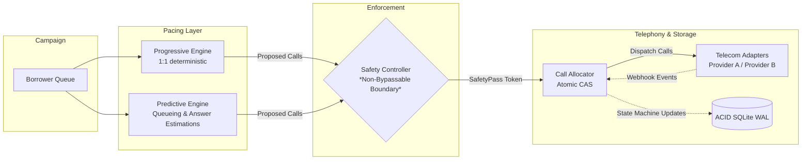

# SmartDialer: High-Performance, Safety-Constrained Outbound Dialing Engine

[](https://www.python.org/)
[]()
[]()

A robust, concurrency-safe collections dialing prototype implementing both **Progressive** and **Predictive** dialing modes with a non-bypassable **Safety Controller**, atomic Compare-And-Swap (CAS) state synchronization, and resilient telecom adapters.

Built for the technical assignment requirements detailed in [Tech Assignment - Hiring 2026.pdf](file:///c:/Users/jayan/OneDrive/Desktop/CREDRESOLVE/Tech%20Assignment%20-%20Hiring%202026.pdf).

---

## 1. Architectural Highlights



- **Non-Bypassable Safety Controller**: Sits strictly between Pacing logic and Telecom Providers. The Call Allocator validates an authentic `SafetyPass` for every outbound dial, raising `SafetyBypassProhibitedError` if bypassed.
- **Atomic Compare-And-Swap (CAS)**: Prevents two workers from ever reserving the same available agent or borrower concurrently.
- **Chaos-Resilient Webhook Processor**: Deduplicates identical telecom events and handles out-of-order events (e.g. `COMPLETED` before `ANSWERED`) via monotonic progression ranks.
- **Worker Crash & Lease Sweeper**: Leased reservations expire automatically if a worker node crashes mid-flight, restoring orphaned agents and borrowers without manual intervention.
- **Provider Circuit Breaker**: Auto-trips to `OPEN` when carrier timeouts spike, instantly halting dials to protect borrowers and campaign integrity.

---

## 2. Quickstart & Setup

### Prerequisites
- Python 3.11+
- Git

### 1. Initialize Virtual Environment & Install Dependencies
```bash
# Create virtual environment
python -m venv .venv

# Activate virtual environment
# Windows:
.venv\Scripts\activate
# Linux/macOS:
source .venv/bin/activate

# Install dependencies (pytest, pytest-asyncio)
pip install -r requirements.txt
```

### 2. Run Test Suite
Run the full automated test suite verifying state machines, atomic CAS concurrency, telecom resilience, and worker crash recovery:
```bash
pytest -v
```

### 3. Run Simulation Scenarios (A, B, C, D)
Compare Progressive vs. Predictive pacing across varying answer rates (20%, 50%, 70%, fluctuating), talk times, and carrier chaos with explainable tick rationale:
```bash
python run_simulation.py
```

### 4. Run Failure Mode Demos
Demonstrates resilience across worker crashes, carrier outages, agent drops, duplicate events, out-of-order events, and prediction collapses:
```bash
python run_failure_demos.py
```

### 5. Run Concurrency & Pipeline Load Test
Executes both the full pipeline load test (10 concurrent workers) and the isolated atomic CAS contention benchmark:
```bash
python run_load_test.py
```

---

## 3. Simulation Benchmark Results

Results generated across the four assignment scenarios (guaranteeing **0 abandoned connected calls** in all scenarios):

| Scenario | Conditions | Mode | Dials | Connects | 20-Seed Mean Util % (Min/Max) | Abandoned Calls | Abandon Rate |
| :--- | :--- | :--- | :--- | :--- | :--- | :--- | :--- |
| **Scenario A** | Answer Rate: 20%, Talk: 120s | Progressive | 374 | 74 | **5.30%** [2.8% - 8.6%] | 0 | **0.0%** |
| | | Predictive | 374 | 74 | **6.47%** [3.6% - 8.9%] *(+1.17% paired diff)* | 0 | **0.0%** |
| **Scenario B** | Answer Rate: 50%, Talk: 90s | Progressive | 311 | 139 | **6.69%** [3.3% - 12.5%] | 0 | **0.0%** |
| | | Predictive | 297 | 151 | **8.00%** [0.0% - 12.2%] *(+1.31% paired diff)* | 0 | **0.0%** |
| **Scenario C** | Answer Rate: 70%, Talk: 180s | Progressive | 273 | 183 | **16.05%** [9.4% - 41.9%] | 0 | **0.0%** |
| | | Predictive | 267 | 187 | **22.14%** [9.2% - 42.2%] *(+6.08% paired diff)* | 0 | **0.0%** |
| **Scenario D** | Dynamic 20-80%, Agent Drops, Jitter | Progressive | 325 | 155 | **20.22%** [15.3% - 26.1%] | 0 | **0.0%** |
| | | Predictive | 340 | 178 | **18.10%** [11.7% - 24.2%] *(-2.13% paired diff)* | 0 | **0.0%** |

*Note on Deterministic Safety vs. Statistical Pacing:*
- **What the Deterministic Cap Gains**: Unconditional zero abandoned calls ($0.0\%$ in all scenarios and seeds). Even under catastrophic 100% answer bursts or sudden agent drops, in-flight calls are clamped to guaranteed available capacity, eliminating regulatory compliance risk.
- **What it Costs**: In low-answer regimes (Scenarios A & B), agent utilization gains over progressive dialing are modest (+1.17% to +1.31%) because predictive dialing cannot launch speculative over-dials without risking abandonment. In volatile dynamic campaigns (Scenario D), progressive dialing achieves +2.12% higher utilization because it operates without EMA estimation lag or conservative safety clamping.

---

## 4. Honest Concurrency & Load Test Methodology

Our load test separates full pipeline throughput from low-level storage lock contention:

### Part 1: Full Dialing Pipeline Test
Pushes calls through the entire software stack (**Pacing Engine $\rightarrow$ Safety Controller $\rightarrow$ Call Allocator $\rightarrow$ Telecom Provider $\rightarrow$ Webhook Ingestion $\rightarrow$ SQLite**):
- **Concurrent Workers**: 10
- **Throughput**: ~350 calls/second
- **Double-Allocated Agents**: **0** (Invariant Verified)
- **Duplicate Borrowers**: **0** (Invariant Verified)
- **Illegal State Transitions**: **0** (Invariant Verified)

### Part 2: Isolated SQLite CAS Contention Benchmark
Measures raw atomic Compare-And-Swap (CAS) row locking under extreme multi-worker parallelism:
- **Concurrent Workers**: 15
- **Locks Acquired**: 800
- **Throughput**: ~2,500+ ops/sec
- **Double-Allocated Agents**: **0** (Zero Race Conditions)

---

## 5. Repository Structure

```
CREDRESOLVE/
├── README.md                          # Quickstart, overview, and benchmark reports
├── ARCHITECTURE.md                    # In-depth ADR and answers to all PDF interview questions
├── requirements.txt                   # Dependency manifests
├── pytest.ini                         # Pytest configuration
├── run_simulation.py                  # CLI runner for Scenarios A, B, C, D (with explainable ticks)
├── run_failure_demos.py               # CLI runner demonstrating all 6 failure & recovery scenarios
├── run_load_test.py                   # High-concurrency pipeline and CAS stress test runner
│
├── smart_dialer/
│   ├── models/
│   │   ├── agent.py                   # Agent lifecycle (OFFLINE, AVAILABLE, RESERVED, DIALING, ...)
│   │   ├── call.py                    # Call lifecycle (QUEUED, RESERVED, INITIATED, RINGING, ...)
│   │   └── borrower.py                # Borrower records and attempt tracking
│   ├── storage/
│   │   ├── base.py                    # Storage interface definition
│   │   └── sqlite_store.py            # Thread-safe SQLite WAL store with atomic CAS updates
│   ├── telecom/
│   │   ├── provider.py                # TelecomProvider base interface & webhook types
│   │   ├── mock_provider_a.py         # Provider A: Fast, reliable, clean event stream
│   │   ├── mock_provider_b.py         # Provider B: Slower, timeouts, duplicates, out-of-order events
│   │   └── circuit_breaker.py         # Telecom outage detection & circuit breaker
│   ├── pacing/
│   │   ├── progressive.py             # 1:1 agent-to-call progressive engine
│   │   └── predictive.py              # Statistical queueing & EMA answer rate predictive engine
│   ├── safety/
│   │   └── safety_controller.py       # Mandatory non-bypassable Safety Controller
│   ├── core/
│   │   ├── dialer.py                  # Pipeline orchestrator: Campaign -> Pacing -> Safety -> Allocator
│   │   ├── event_handler.py           # Idempotent, out-of-order resilient webhook processor
│   │   └── worker.py                  # Distributed worker model & lease recovery sweeper
│   └── simulation/
│       ├── simulator.py               # Benchmark engine for Scenarios A, B, C, D
│       └── load_test.py               # Multi-worker concurrency harness
│
└── tests/
    ├── test_state_machines.py         # Unit tests for state models and valid transitions
    ├── test_concurrency_cas.py        # Race condition tests for simultaneous agent reservations
    ├── test_safety_controller.py      # Non-bypassability, limits, and fallback tests
    ├── test_telecom_resilience.py     # Duplicate and out-of-order webhook delivery tests
    ├── test_crash_recovery.py         # Worker crash and lease reconciliation tests
    └── test_pacing_engines.py         # Progressive and Predictive algorithm math verification
```

---

## 6. Architecture Decision Record (ADR) & Interview Defense

Detailed answers to all technical questions and failure edge cases from the assignment PDF are documented in [ARCHITECTURE.md](file:///c:/Users/jayan/OneDrive/Desktop/CREDRESOLVE/ARCHITECTURE.md):

1. **Stack Trade-Offs**: Why Python + SQLite WAL + Asyncio was chosen, what problems it solves, and what it makes harder.
2. **Race Conditions**: Exact walk-through of two workers attempting to reserve the same agent at the exact same millisecond.
3. **Cache vs. Database**: Why the database is authoritative when cache says `RESERVED` and DB says `AVAILABLE`.
4. **Crash Recovery**: Handling `ANSWERED` followed by worker crash, followed by `COMPLETED`.
5. **Answer Rate Collapse**: How the system protects itself when predicted 70% answer rate abruptly plunges to 10%.
6. **Scaling Bottlenecks**: Exact failure points going from 100 $\rightarrow$ 1,000 $\rightarrow$ 10,000 $\rightarrow$ 100,000 agents and architectural solutions (pod sharding, Redis Lua CAS, Kafka event streams).
7. **Pacing Math**: Detailed derivation of why the algorithm initiates 17 calls instead of 10.
8. **Final Question**: How to build a SmartDialer that maximizes predictive utilization while retaining deterministic progressive safety (*Adaptive Dual-Reservoir Dialing*).
